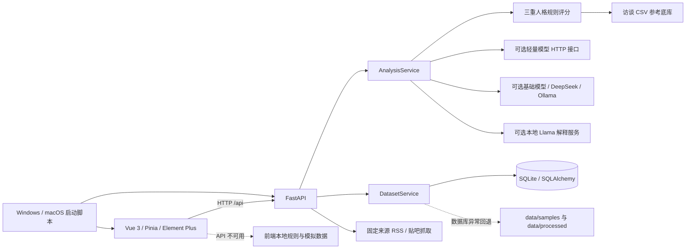

# 仓库审查报告（2026-10-19）

## 结论

当前仓库已经跑通“文本输入 → 三重人格规则评分 → 可选模型解释 → 数据集展示”的演示闭环，但尚不是科研级资源管理系统。核心评分是探索性关键词与密度规则；前端在 API 失败时会切换到本地规则或模拟数据；研究材料缺少统一元数据、授权记录、版本化迁移、证据定位和访问控制。

本次审查前工作区为 `main`、HEAD `c824cbc`，仅有尚未提交的跨平台启动改动。审查未修改业务数据、人格理论或分析结果。

## 模块与依赖关系

## 已真实实现的功能

- FastAPI 健康检查、单条分析、批量分析、解释生成、数据集列表/详情、参考底库、公开来源、模型档案和系统状态接口。
- 三重人格结构及 15 个细分指标；计算关键词命中、线索多样度、段落覆盖率和千字证据密度。
- 长文本分段、维度汇总、规则解释、可选 OpenAI 兼容模型解释及不可用时降级。
- SQLite/SQLAlchemy 数据集读取；数据库为空时可从 CSV 建库；支持 SQLite 到 MySQL 的迁移脚本。
- Vue 大屏、统计图表、词云、搜索筛选、详情抽屉、TXT/CSV 浏览器端解析、公开文本获取入口和模型档案切换。
- 受控的少量公开源抓取代码：固定 RSS 地址及指定贴吧名称，不接收任意 URL。
- Windows 启动脚本和新增 macOS 启动脚本。

## 模拟、回退与占位能力

- `frontend/src/constants/mock.ts` 包含完整模拟驾驶舱与参考库数据；页面启动时先以模拟数据初始化。
- 后端不可用时，单条和批量分析自动改用 `frontend/src/utils/fallbackAnalysis.ts`，界面会显示 `connectionMode=mock`，但仍可能被非技术用户误当作后端科研结果。
- 小模型只有 HTTP 接口封装，仓库没有训练产物、模型权重、数据划分或评测报告。
- 本地 Llama 需要仓库外权重；`models/` 只有说明文件。
- 公开数据接口代码是真实请求，但现有自动化测试使用替代响应，不证明外部来源长期可用。
- “强模型档案切换”保存在当前进程内存中，重启后不会形成可复现的分析运行记录。
- 当前前端文件导入只支持 TXT/CSV，且只进入当前浏览器会话和分析接口，没有持久化资源、来源、文件哈希或导入任务。

## 现有数据库

SQLite 文件 `data/app.db` 完整性检查为 `ok`，包含：

| 表 | 记录数 | 用途 |
| --- | ---: | --- |
| `corpus_datasets` | 3 | 数据集名称、文件名、领域、默认状态和更新时间 |
| `corpus_records` | 1341 | 文本、分类、等级、分数、关键词、解释和关注标记 |

`corpus_records.dataset_id` 声明了到 `corpus_datasets.id` 的外键并建有索引。当前 SQLite 连接没有显式启用 `PRAGMA foreign_keys=ON`，因此声明不等于运行时强制一致性。数据库没有迁移版本表，也没有资源作者、版权状态、原始文件、文档分段、教育家人物、证据位置或分析运行记录。

现有三个数据集为通用演示文本、访谈分析集和访谈导入集。访谈导入集与分析集各含 669 条衍生文本，数据库总记录数因此包含同源文本的两种形态。

## 已有研究材料及接入状态

| 材料 | 当前状态 | 主要问题 |
| --- | --- | --- |
| 教育家型教师访谈 DOCX | 已提取为 TXT/CSV，并进入 SQLite | 含真实姓名、性别、教龄、任教学科和逐段回答；授权与公开范围未记录 |
| 访谈导入/分析 CSV | 已被运行时读取 | 至少 10 名具名受访者，且前端参考库接口会返回原文样例和姓名 |
| 蔡元培人物表现 TXT | 未进入统一数据库 | 缺来源、版本、引用和授权元数据 |
| 蔡元培画传 DOCX | 未接入 | 约 11.9 MB；来源与再分发授权未记录 |
| 三重人格理论论文 PDF | 用于理论参照，但未建立资源记录和页码证据 | 版权、正式引文和全文公开许可未记录 |
| 纯展示版 HTML | 独立展示文件，未与当前 Vue/FastAPI 链路整合 | 容易与真实运行系统混淆 |
| 约 14 本后续书籍 | 当前仓库未发现 | 必须以用户实际提供清单为准，不得虚构 |

## 风险清单

### 阻断级

1. **公开仓库含具名访谈资料。** 原 DOCX、原始 TXT、导入 CSV 和分析 CSV 含受访教师姓名及人口/职业属性和完整回答。尚未发现手机号、身份证号或邮箱格式，但这不构成充分去标识化。确认知情同意、公开范围和二次分析授权前，不应继续公开推送全文或衍生数据。
2. **材料授权状态缺失。** 仓库没有 LICENSE，也没有逐资源版权/授权清单。传记 DOCX、论文 PDF、访谈和展示 HTML 的公开再分发权无法从仓库证明。

### 高风险

1. 前端 API 失败时自动返回本地规则/模拟结果，科研场景可能混淆“真实后端结果”和“演示降级结果”。
2. 无用户认证、访问控制和资源级权限；若服务绑定到非本机地址，研究全文和访谈数据会直接暴露。
3. SQLite 未显式开启外键强制，且没有版本化迁移机制。
4. 数据库初始化和查询异常被宽泛捕获后静默退回 CSV，可能掩盖数据库损坏或配置错误。
5. 当前规则含明确“叙事长度增益”，文本越长会直接获得额外分数；关键词交叉、否定、引用他人观点和文体偏差尚未系统验证。

### 中风险

1. `backend/.env.example`、部分部署文档和迁移脚本仍含旧 Windows 绝对路径。
2. API 地址在前端固定为 `127.0.0.1:8000`，不便反向代理或非本机部署。
3. 外部请求缺少统一审计日志、频率限制和来源条款记录；贴吧内容还涉及平台规则和个人公开内容的研究伦理。
4. npm 安装报告 10 个依赖漏洞（2 个中危、8 个高危），需要逐项核对生产影响，不能直接使用破坏性自动升级。
5. 前端生产包主 JS 约 2.1 MB，缺少路由级拆分。

### 测试与科研限制

- 现有后端 17 项测试通过，但以单元/API 骨架测试为主；数据库迁移、真实文件解析、访问控制、外部请求失败、数据版本和证据溯源尚无覆盖。
- 当前分数只能描述规则线索显现度，不能称为经过效度验证的人格心理测量结果。
- 仓库没有人工标注协议、标注一致性、训练/测试隔离、F1、置信区间或消融实验记录。

## 保护与验证记录

- 本地备份分支：`backup/pre-2.0-20261019-c824cbc`，指向改造前提交 `c824cbc`。
- 数据库备份：项目外 `outputs/word-embedding-emotional-analysis-system/backups/2026-10-19/app.db.c824cbc.bak`。
- 数据库原件与备份 SHA-256：`2660C31ACBA99A693EA31BA926BCF60717B9C57FC29ED6511C5F7E364B4664F4`。
- Windows 基线：后端 `17 passed`；前端生产构建通过；实际启动后 `/health=ok`、数据集数为 3、前端返回 HTTP 200；测试进程和 5173/8000 监听均已清理；数据库哈希未改变。
- macOS：仅完成脚本静态和模拟检查，尚未在真实 Mac 上验收。

## P1 实施边界

资源库默认采用 `restricted` 访问级别和明确的版权状态；原始上传文件存放在 Git 忽略的受控运行目录，不进入公开仓库。只有调用方明确声明允许保存全文时才提取并持久化全文与分段。第一轮不自动迁移现有具名访谈资料，避免在授权未确认时扩大处理和暴露范围。

## P1 实施与复核结果

- 已加入 Alembic 迁移和 6 张资源域表，应用启动仍只兼容初始化旧语料表，不会静默创建资源表。
- 已加入资源解析、逐文件导入任务、SHA-256 去重、版权/全文开关、服务端生成存储路径、资源列表与详情 API。
- 已加入 `/resources` 前端页面；前端 API 根地址可通过 `VITE_API_BASE_URL` 配置。
- 后端全量测试为 `27 passed`，覆盖迁移保留旧数据、资源服务、API、版权开关、去重、重复证据位置保留及 8 类文件的关键解析行为。
- 前端生产构建通过；主包仍约 2.1 MB，作为后续性能优化项保留。
- `data/app.db` 副本迁移后 `integrity_check=ok`，旧数据仍为 3 个数据集和 1341 条语料，6 张资源表全部存在；仓库原件 SHA-256 前后均为 `2660C31ACBA99A693EA31BA926BCF60717B9C57FC29ED6511C5F7E364B4664F4`。
