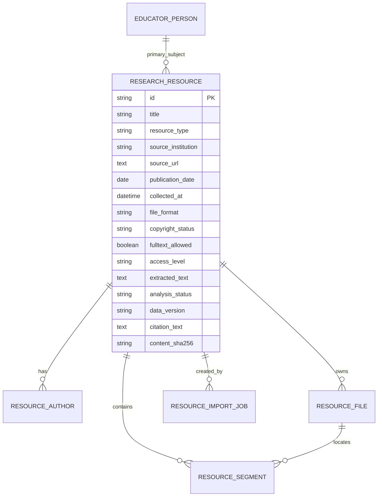

# 多源研究资源库数据库与 API 设计

## 设计目标

在保留 `CorpusDataset`、`CorpusRecord` 的前提下新增研究资源域。语料表继续服务现有大屏，资源表负责来源、版权、原始文件、分段定位和导入过程。两者暂不强制合并，后续通过可追溯的分析运行把资源分段映射为实验语料，避免破坏现有数据。

## 数据关系

## 表说明

- `educator_persons`：教育家人物规范名称、别名和说明。
- `research_resources`：一条书籍、访谈、论文、视频字幕、网页、政策或研究笔记的统一记录。
- `resource_authors`：作者、受访者、编者、译者等多值贡献者。
- `resource_files`：原始文件的受控路径、格式、大小、哈希和解析状态。
- `resource_segments`：可定位的文本分段；定位值可表示页码、段落、工作表行号或字幕时间戳。
- `resource_import_jobs`：每个文件的导入状态、失败原因、去重结果和重试次数。
- `alembic_version`：由 Alembic 维护的已应用数据库结构版本。

所有主键使用字符串 UUID，时间存 UTC。文件哈希用于精确去重，资源标题搜索用于用户检索，不以标题近似匹配代替内容哈希。

## 第一轮 API

| 方法 | 路径 | 用途 |
| --- | --- | --- |
| `GET` | `/api/research-resources/stats` | 总量、类型、状态和版权状态统计 |
| `GET` | `/api/research-resources` | 关键词、类型、人物、状态筛选及分页 |
| `GET` | `/api/research-resources/{id}` | 元数据、作者、文件和可定位分段详情 |
| `POST` | `/api/research-resources/import` | 多文件导入；每个文件独立返回成功、重复或失败 |
| `GET` | `/api/research-import-jobs` | 查看最近导入任务及错误信息 |

导入接口使用 `multipart/form-data`。元数据在同一批文件中共享，文件名仅作为显示信息；服务端保存名由 UUID 和哈希生成，不能控制写入路径。

## 支持格式和定位

| 格式 | 第一轮解析 | 定位信息 |
| --- | --- | --- |
| TXT | UTF-8/UTF-8-SIG/GB18030 文本 | 段落 |
| CSV | 优先 `text/文本/内容/body` 列 | 行号 |
| DOCX | OOXML 段落文本 | 段落号 |
| PDF | 文本型 PDF | 页码 |
| XLSX | 各工作表非空行 | 工作表和行号 |
| JSON | 字符串、列表和常见文本字段递归提取 | JSON 路径 |
| SRT/VTT | 字幕块 | 起止时间戳 |

扫描型 PDF 若没有可提取文本，任务失败并记录“需要 OCR”，第一轮不自动执行 OCR。

## 数据保护规则

1. 默认 `access_level=restricted`、`copyright_status=unknown`、`fulltext_allowed=false`。
2. 未明确允许保存全文时，仅保存资源元数据、文件摘要和导入任务，不保存原文件、全文或分段。
3. 允许保存全文时，原文件进入 `backend/runtime/research_resources/`；该目录已被 Git 忽略。
4. 文件大小、扩展名和解析器均采用允许列表；服务端不使用客户端文件名拼接路径。
5. 导入失败不会静默丢弃，任务记录保留错误类型和可读原因。
6. API 第一轮仍为本地研究环境功能。部署到共享网络前必须补访问控制、审计日志和恶意文件隔离。

## 迁移策略

新增 Alembic 迁移只创建资源域表和索引，不修改 `corpus_datasets`、`corpus_records` 或现有 SQLite 数据。测试在临时数据库和 `app.db` 副本上执行升级；本轮不直接升级仓库跟踪的 `data/app.db`，以免静默改写历史数据。应用启动时只对旧语料表保留兼容初始化，不会静默创建资源表；正式部署应先执行 `alembic upgrade head`。

## 后续扩展

第二轮再加入 `AnalysisRun`、`EvidenceRecord`、`ResearchAnnotation`、多人标注与资源—人物多对多关系。证据表必须引用 `resource_segment_id` 和分析版本，才能支撑页码/段落/时间戳级溯源。
